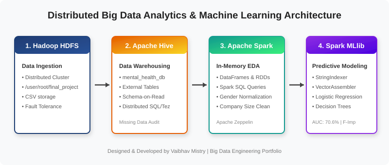
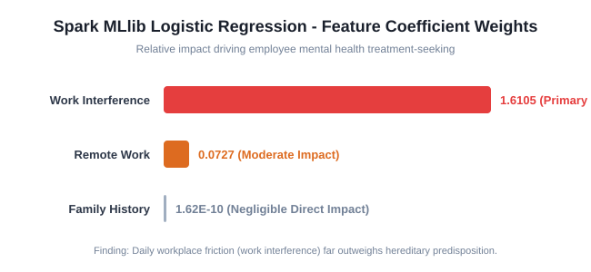
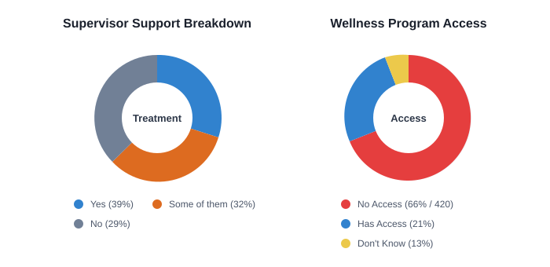
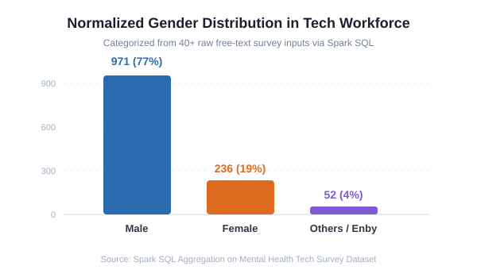
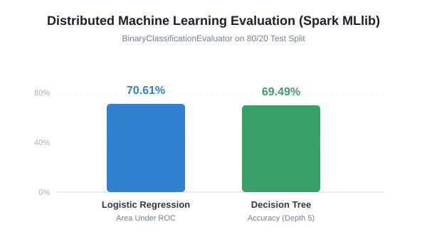

<div align="center">

# 🧠 Workplace Mental Health Analytics
### A Distributed Big Data & Machine Learning Pipeline Using Hadoop, Hive, and Apache Spark

[](https://spark.apache.org/)
[](https://hive.apache.org/)
[](https://hadoop.apache.org/)
[](https://www.python.org/)
[](LICENSE)

<p align="center">
  <b>Analyzing workplace mental health trends, quantifying organizational risk factors, and training distributed predictive models for early workplace intervention.</b>
</p>

</div>

---

## 📌 Executive Summary

Workplace mental health is a vital determinant of organizational success, team retention, and employee wellbeing. This project establishes an enterprise-grade distributed Big Data and Machine Learning pipeline to analyze multi-national workforce survey data across the technology sector.

By combining **Hadoop HDFS** for scalable distributed storage, **Apache Hive** for schema-on-read data warehousing, and **Apache Spark / MLlib** for in-memory analytics and predictive classification, this platform surfaces actionable, data-driven insights for HR leaders and executives.

<div align="center">
  
  <p><i>Figure 1: End-to-end distributed Big Data and Machine Learning architecture.</i></p>
</div>

---

## 📊 Key Findings from the Analysis

### 1. Work Interference is the Primary Driver of Treatment-Seeking
Multivariate Logistic Regression trained via **Spark MLlib** identified that daily **work interference** is by far the single most influential determinant of whether an employee requires mental health support.

<div align="center">
  
  <p><i>Figure 2: Spark MLlib feature coefficient weights illustrating that workplace friction far outweighs hereditary predisposition.</i></p>
</div>

- **Work Interference (1.6105)**: The dominant factor driving mental health treatment.
- **Remote Work (0.0727)**: Secondary factor, reflecting unique isolation dynamics.
- **Family History (1.62E-10)**: Negligible direct impact compared to workplace environment.

---

### 2. The Corporate Wellness Deficit
Despite growing awareness, **66% of surveyed employees actively seeking treatment report having no access to mental health wellness programs** at their workplace.

<div align="center">
  
  <p><i>Figure 3: Breakdown of supervisor support and wellness program availability.</i></p>
</div>

- **Supervisor Support**: 39% of treatment seekers cite supportive supervisors, while 32% cite partial support. Direct manager empathy strongly correlates with psychological safety.
- **Resource Accessibility**: Only 21% of respondents confirmed available wellness programs.

---

### 3. Demographic & Age Dynamics
- **Peak Treatment Window**: Treatment-seeking behavior peaks intensely between ages **25 and 35**, declining steadily after age 40.
- **Gender Normalization**: 40+ raw free-text survey responses were standardized into three primary cohorts: **Male (77%)**, **Female (19%)**, and **Non-Binary / Others (4%)**.

<div align="center">
  
  <p><i>Figure 4: Standardized gender distribution across tech workforce respondents.</i></p>
</div>

---

## 🏆 Distributed Machine Learning Benchmark

Two scalable classifiers were built using **Spark MLlib** to predict treatment-seeking propensity on an 80/20 train-test split:

| Model Architecture | Metric | Score | Key Takeaway |
| :--- | :---: | :---: | :--- |
| **Logistic Regression (MLlib)** | **Area Under ROC** | **70.61%** | Clear, interpretable probabilistic decision boundaries |
| **Decision Tree Classifier (MLlib)** | **Accuracy** | **69.49%** | Non-linear tree (depth 5, 49 nodes) validating key splits |

<div align="center">
  
  <p><i>Figure 5: Predictive modeling evaluation on distributed test data.</i></p>
</div>

---

## 💡 Strategic Recommendations for Organizations

1. **Active Workload Management**: Because work interference is the primary driver of burnout, organizations should adopt flexible schedules and monitor delivery pressure.
2. **Supervisor Mental Health Literacy**: Train engineering managers and team leads to recognize early signs of burnout and support open dialogue without stigma.
3. **Closing the EAP Gap**: Implement dedicated, confidential Employee Assistance Programs (EAPs) with transparent guidelines.
4. **Targeted Support for Ages 25–35**: Focus mental health outreach on early-to-mid career professionals who experience the highest stress transitions.

---

## 📂 Project Structure

```bash
workplace-mental-health-big-data/
├── assets/                             # Architecture & analytical vector diagrams
│   ├── architecture_pipeline.svg       # End-to-end Big Data pipeline
│   ├── feature_importance.svg          # MLlib feature coefficient weights
│   ├── gender_distribution.svg         # Normalized demographic breakdown
│   ├── mllib_performance.svg           # Model comparison benchmark
│   └── workplace_insights.svg          # Supervisor and wellness donut charts
├── data/                               # Raw survey dataset (1,260 records, 24 attributes)
│   └── Mental_Health_in_Tech_Survey_dataset.csv
├── docs/                               # Formal analysis reports
│   └── Project_Report.md               # In-depth technical and policy report
├── hdfs/                               # Cluster ingestion scripts
│   └── setup_hdfs.sh                   # Automated HDFS directory and file provisioning
├── hive/                               # Apache Hive warehousing scripts
│   ├── 01_create_database.hql          # Database initialization
│   ├── 02_create_external_table.hql    # External schema-on-read table
│   ├── 03_data_cleaning_audit.hql      # Distributed null audit across 24 columns
│   └── 04_eda_queries.hql              # Aggregations, correlations, and cross-tabulations
├── notebooks/                          # Interactive exploration
│   └── workplace_mental_health_big_data.ipynb  # PySpark replica notebook
├── spark/                              # Scala Spark & Spark MLlib scripts
│   ├── 01_data_ingestion_and_eda.scala # In-memory transformations & Spark SQL
│   └── 02_mllib_predictive_modeling.scala # Pipeline, StringIndexer, LR & DT models
├── requirements.txt                    # Python / PySpark environment dependencies
└── README.md                           # Main documentation & visual dashboard
```

---

## 🚀 Quickstart & Setup Guide

### 1. Ingest Data into HDFS
```bash
bash hdfs/setup_hdfs.sh
```

### 2. Deploy Hive External Schema
```bash
hive -f hive/01_create_database.hql
hive -f hive/02_create_external_table.hql
hive -f hive/03_data_cleaning_audit.hql
```

### 3. Run Spark In-Memory Analytics & MLlib
```bash
spark-shell -i spark/01_data_ingestion_and_eda.scala
spark-shell -i spark/02_mllib_predictive_modeling.scala
```

---

## 👤 Author

**Vaibhav Mistry**  
- **GitHub**: [@vaibhavmistryyy](https://github.com/vaibhavmistryyy)  
- **Repository**: [vaibhavmistryyy/workplace-mental-health-big-data](https://github.com/vaibhavmistryyy/workplace-mental-health-big-data)
